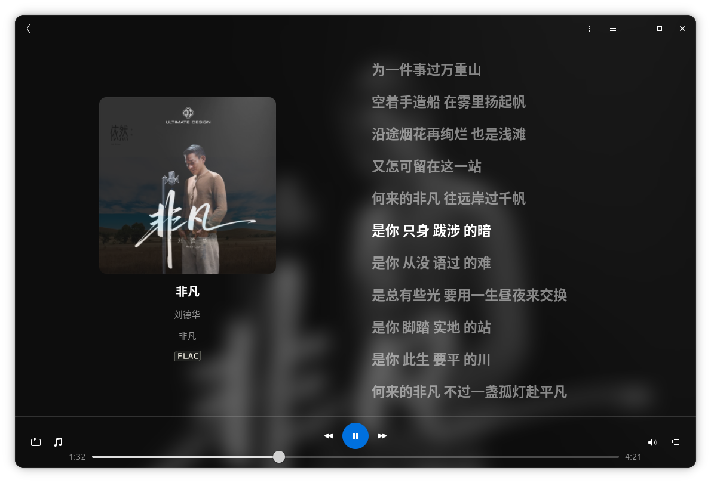
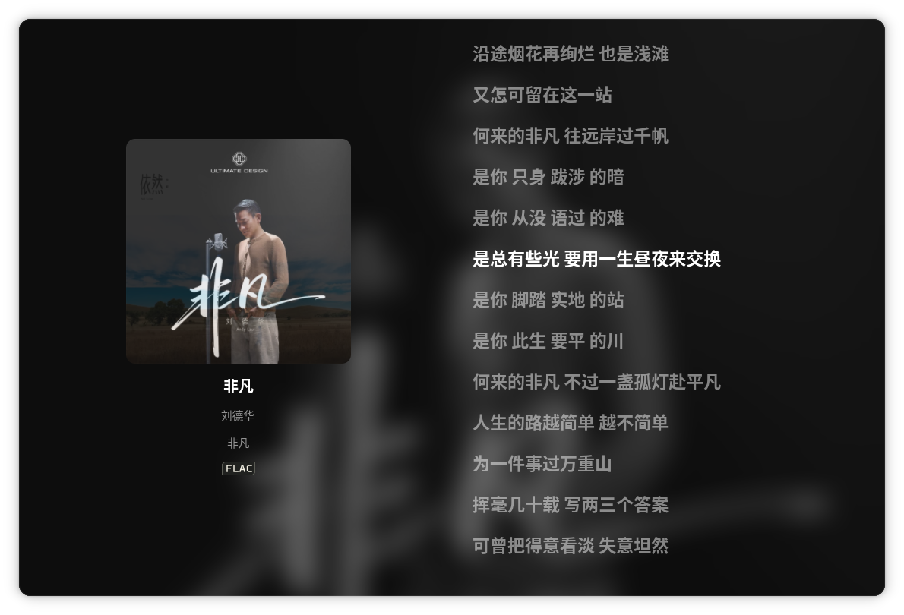
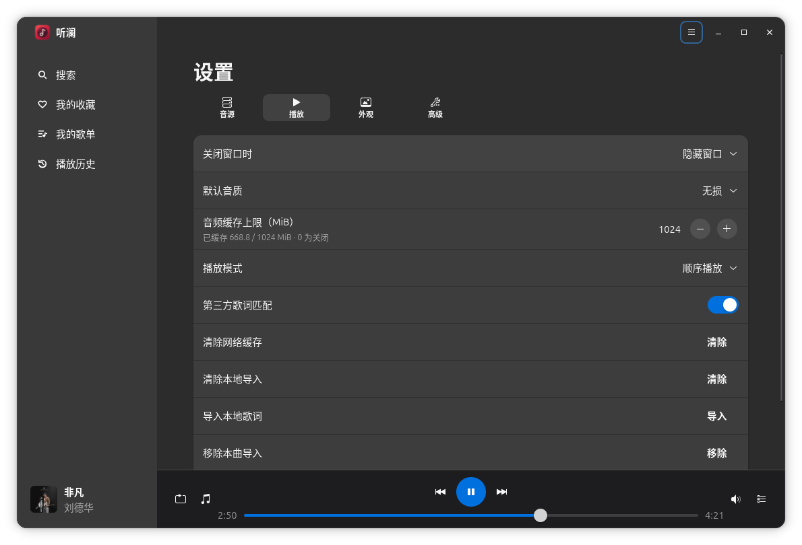
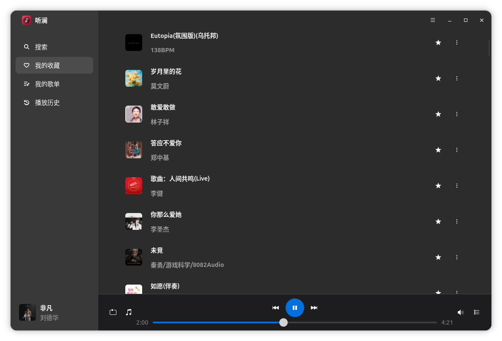
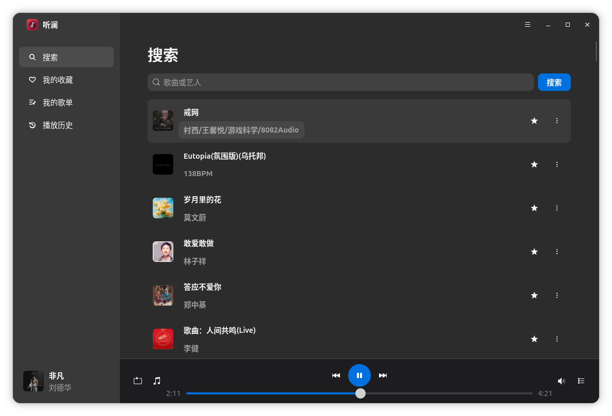
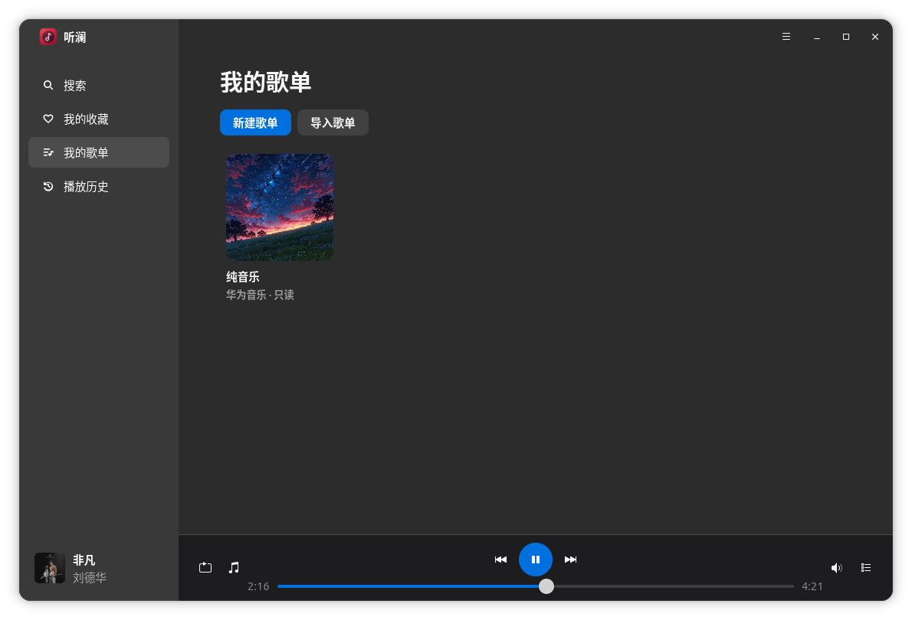

<p align="center">
  
</p>
<h1 align="center">听澜 · Tinglan (GTK)</h1>
<p align="center"><strong>fork 自 https://github.com/talongao/tinglan </strong></p>
<p align="center">基于音源插件架构的Linux 桌面音乐客户端 · Go 后端 + GTK4 / libadwaita 界面 · 可扩展 · 数据留存本机</p>
<p align="center">
  <a href="#核心特性">核心特性</a> ·
  <a href="#功能与架构详解">功能架构</a> ·
  <a href="#快速开始">快速开始</a> ·
  <a href="#从源码构建">源码构建</a> ·
  <a href="#路线图与验收状态-roadmap">路线图</a> ·
  <a href="#参与贡献-contributing">参与贡献</a>
</p>



> **免责声明**：本项目为非官方、实验性开源项目，与各音乐平台无隶属或合作关系。客户端仅播放用户账号已有权益允许的音频流，严格遵守各平台服务条款、会员权益及地域限制，Linux 播放器可将已获授权的音频暂存于有容量上限的私有播放缓存，复用前仍会向音源解析播放权限；不提供下载导出、离线播放或媒体文件处理功能。完整说明请参阅[免责声明与使用边界](docs/DISCLAIMER.md)。

## 项目简介

**听澜（Tinglan）** 是一款面向 Linux 的桌面音乐客户端，使用 **Go 后端与 [GTK4](https://www.gtk.org/) / [libadwaita](https://apps.gnome.org/Libadwaita/) 界面**。它通过模块化的**音源插件**接入流媒体平台——只需登录你自己的平台账号，即可在桌面端直接浏览、搜索与播放音乐，无需借助手机充当播放器。

界面使用 Python / PyGObject，通过标准输入输出上的 JSON 与 Go 后端通信，不开启本地网络端口。播放、音源插件和数据读写沿用 Go 实现；桌面应用不依赖 Electron 或 Node.js。

## 核心特性

**原生、可扩展、数据留在本机。** 界面采用 GTK 原生控件；音乐平台以独立进程的音源插件接入，插件写什么语言都行；曲库按「一首歌一行、多来源挂载」存在本地，换平台、换账号、曲目下架都不会丢收藏。

- **听歌**：逐字歌词与双语排版、本地 LRC / TXT、跟随系统的外观设置与系统媒体控制。
- **找歌**：多源搜索页签、收藏与歌单、本机播放历史。
- **可控**：灰区决策模型默认关闭，关掉不产生任何费用；登录会话与 API Key 加密存在本机，不碰系统钥匙串。

## 功能与架构详解

### 1. 音源插件架构（Source Plugins）

听澜不将任何音乐平台逻辑硬编码在宿主程序中。通过「设置 → 音源 → 添加音源」导入 `.zip` 音源包并在首次启用时确认，即可完成平台接入——搜索、歌单、专辑、艺人、音频流解析与歌词均由插件动态提供。重复导入同 ID 音源包即可平滑升级，自动保留启用状态与登录会话。

- **独立进程，语言无关**：每个音源作为独立进程启动，通过标准输入输出（`stdio`）上的 JSON-RPC 2.0 与宿主交互。只要能从命令行启动，编译型二进制或自带解释器的脚本均可作为插件运行。
- **动态能力自报（Capability Negotiation）**：握手阶段由插件主动声明显示名称、图标及支持的能力集（搜索、歌单、导入、播放解析、歌词、写操作等），宿主界面根据声明的能力动态渲染功能入口。
- **极简插件开发**：插件源码集中存放于仓库 `plugins/<id>/` 目录，由作者在 `source.json` 中维护稳定的 `id` 与 `version`。只需十余分钟即可编写出一个可搜索、可播放的音源插件。

📚 **插件开发文档**：[插件开发指南](docs/PLUGIN_GUIDE.md) · [插件协议](docs/SOURCE_PLUGIN_PROTOCOL.md) · [音源契约](docs/SOURCE_CONTRACT.md)

### 2. 沉浸听歌与歌词排版

**有些歌想跟着唱，有些歌想读懂。**

当前演唱行实时保持高亮；当服务端返回逐字时间轴（TTML）时，支持逐字点亮动效。歌词源自带的音译或译文会自动排版在原句下方——听澜专注于精准排版，不自行生成机器翻译。

- **智能滚动跟随**：默认随播放进度自动跟随；手动滚动后停留 5 秒，无操作便平滑回到当前歌词。
- **本地歌词与偏移校准**：支持手动导入本地 LRC / TXT 歌词，也能按歌曲独立调整时间偏移。
- **全局与快捷控制**：应用内按空格键暂停或继续，系统托盘与系统媒体控制随手可用。在同一桌面会话中再次打开听澜，会唤回已有窗口，不会重启播放。
- **直觉化播放交互**：音质、播放顺序、音量采用轻量上浮菜单；打开播放队列即自动定位至当前播放歌曲。
- **异常自动容错**：流解析或解码失败时自动跳至下一首，同时在播放器上保留显式的重试入口。

<details>
<summary><strong>看看 GTK 歌词页 · 隐藏上下栏</strong></summary>



</details>



### 3. 本机曲库与多源挂载

**一首歌一条记录，多个来源挂在它下面。**

同一首录音在听澜中仅占一行，来自不同音源的版本作为「来源」挂载在该行下。收藏、歌单与播放队列均只引用该行的本地 ID——换音源、换账号或某首歌在平台上消失，都不会把本地收藏弄丢。

| 曲库模块 | 机制与行为说明 |
| :--- | :--- |
| **我的收藏** | 纯本地数据。从音源导入收藏只是把对应来源挂载上来；平台侧取消收藏不会删除本机收藏，需在听澜内手动移除。 |
| **本地歌单** | 本地曲目文件夹，可随手新建、加歌、删歌，同一个歌单内的歌曲可以来自不同音源。 |
| **导入歌单** | 平台歌单的只读镜像，仅支持整份更新，内容以平台当前状态为准。 |
| **多源搜索** | 启用两个及以上音源时，搜索页顶部展示平台切换页签；仅启用一个时自动隐藏以减少多余点击。结果随滚动继续加载，点歌直接加入当前队列而不替换已有队列。 |
| **播放历史** | 仅记录在本机，不上传、不同步。 |



| 搜索 | 我的歌单 |
| --- | --- |
|  |  |

更多截图见[界面预览](docs/ui-preview/README.md)。

### 4. 决策模型（可选）

导入收藏或更新歌单时，平台数据常常缺时长、缺版本信息，导致同一首录音在不同专辑里长得几乎一样。听澜采用**「本地规则优先 + 灰区模型兜底」**的两阶段判断机制：

1. **本地规则初筛**：对比标题规范化、艺人、专辑、版本标记与时长差，直接处理特征明确的曲目。
2. **灰区模型判定**：只有落在灰区、本地规则定不下来的成对曲目，才按需交给决策模型辅助判断。

可在「设置 → 高级 → 决策模型」中填写接口地址、API Key 与模型名称，支持先「测试连接」再保存生效：

- **默认关闭**：关闭状态下不发起任何请求，不产生任何费用。
- **最小化信息发送**：仅发送判断所需的曲目元数据（标题、艺人、版本、专辑、时长），绝不发送音频、账号凭据、账号标识或带签名的播放地址。
- **只解决灰区且带缓存**：明显相同或不同的曲目不会调用模型；判定结果带缓存与有效期，手动撤销的合并不会被旧结果重新套用。
- **本机加密存储**：API Key 与登录会话一样保存在本机应用数据目录的加密文件里，不使用系统钥匙串。

### 5. 外观与字体定制

外观支持 **跟随系统、亮色、暗色**，强调色跟随系统。字体可直接从本机已安装字体中搜索选择，字号也能按阅读习惯自由调整。

## 快速开始

### 平台支持状态

这个 GTK fork 仅面向 Linux。GNOME / Wayland 已验证现有华为会话恢复、搜索和播放。Linux x86_64 流水线配置为生成 `.deb`、`.rpm` 和 AppImage，音源包独立提供。

### 启动与音源

- 已有本地测试构建时，从仓库根执行 `./out/native/tinglan`。GTK 界面与资源内嵌在可执行文件里，不用手动运行 Python 脚本。
- 「设置 → 播放 → 音频缓存上限」默认 1024 MiB，设为 0 会关闭并清理缓存。容量不足时先淘汰最久未使用的歌曲。重开后仅在完整缓存上恢复进度；缓存缺失或不可读时从头在线播放。音频缓存不是离线下载，播放仍须经过音源解析。
- 在「设置 → 音源 → 添加音源」导入 Linux 对应架构的音源包并确认启用。已有有效会话可直接复用；需要重新授权时从音源卡片发起登录，Linux 授权使用 Chromium。

## 从源码构建

<details>
<summary><strong>展开查看源码构建与 CI/CD 说明</strong></summary>

### 环境依赖

- **构建**：Go `1.27.3+`、Linux C 工具链。
- **运行**：系统 Python 3、PyGObject、GTK4 和 libadwaita（至少 1.6）。

在 `native/` 下构建：

```sh
go build -o ../out/native/tinglan ./cmd/music
```

Linux 常规构建不需要临时 Go overlay。GitHub Actions 对 PR 只检查和构建；手动运行上传 Artifacts，不发布；`main` 推送在校验三种格式和音源包后才发布。AppImage 仍需要宿主机的 GTK / Python 运行时。

发行版本由 `bash native/scripts/release-version.sh` 计算，格式为 `<tag>.<feat>.<other>`。第一段取当前提交可达的最新手动基准标签（如 `v1`、`v2`，按标签日期），没有基准则用 `0`，从历史起点计数。其余两段分别统计基准标签之后的 `feat:`、`feat(scope):`（含 `!`）和其他提交。自动生成的 Release 标签（如 `v2.3.5`）和旧 `-build.*` 标签不参与选基准。三个应用包和 Release 使用同一个版本号，独立音源包沿用各自的版本。

</details>

## 账号安全与隐私边界

- **本地凭据保护**：登录状态与 API Key 保存在本机应用数据目录的加密文件里，不访问系统钥匙串。凭据保护依赖操作系统用户隔离与文件权限；音乐会话不自动续期，确认失效后需重新登录。
- **账号退出与数据保留**：退出账号仅停用该账号在本机曲库里的来源绑定，不会删除本地收藏；重新登录后收藏依然保留。
- **歌词查询隐私**：在线歌词优先使用音源返回的内容。可选的第三方歌词匹配仅查询歌词、不提供音源，匹配时只发送歌名、艺人等曲目信息，不发送账号凭据，且可在设置中随时关闭。

具体验证范围与待办见[实现状态](docs/IMPLEMENTATION_STATUS.md)，项目不以截图或编译成功代替完整实机验收。

## 路线图与验收状态 (Roadmap)

### 已完成落地

- [x] 独立进程音源插件机制与平滑升级
- [x] 多源聚合曲库、本地歌单与只读导入歌单
- [x] 多音源搜索页签与滚动加载
- [x] TTML 逐字歌词、音译/译文排版与本地歌词导入
- [x] 决策模型灰区判断与缓存机制


## 参与贡献 (Contributing)

欢迎带着使用感受来提 [Issue](https://github.com/talongao/tinglan/issues)，也欢迎提交修问题、改进排版与可访问性、补充 Linux 桌面验证的 Pull Request。

- **贡献第三方音源**：请将插件放在 `plugins/<id>/` 目录下，在 `source.json` 中写清稳定的 `id` 与 `version`，并在插件 README 中说明所需运行时与遵守的平台条款。
- **问题反馈规范**：提 Issue 时请写清系统版本、复现步骤和预期表现；附带截图请避开个人账号信息。
- **安全与合规红线**：请勿提交任何 Token、Cookie、授权码或私人数据。**本项目坚决不接受绕过付费限制、音频解密或未经授权的资源替换。**

📖 **开发资料索引**：[原生开发说明](native/README.md) · [音源插件开发指南](docs/PLUGIN_GUIDE.md) · [插件协议](docs/SOURCE_PLUGIN_PROTOCOL.md) · [音源契约](docs/SOURCE_CONTRACT.md) · [实现状态](docs/IMPLEMENTATION_STATUS.md) · [接口契约](docs/API_CONTRACT.md) · [验证记录](docs/authorized-feature-validation.md)

## 社区与致谢

感谢 [LINUX DO](https://linux.do/) 社区。愿这里也能遇到喜欢折腾桌面、认真听歌的朋友。

- 桌面界面使用 [GTK4](https://www.gtk.org/)、[libadwaita](https://apps.gnome.org/Libadwaita/) 和 [PyGObject](https://pygobject.gnome.org/) 构建
- 界面图标基于 [Lucide](https://lucide.dev/)（ISC）
- 应用图标的许可与归属保留在 [icon.LICENSE.txt](build/icon.LICENSE.txt)

## 开源许可 (License)

本项目代码采用 **AGPL-3.0-only** 许可证开源，详见 [LICENSE](LICENSE) 与 [NOTICE](NOTICE)。

许可证仅覆盖代码本身，不授予音乐内容、商标或服务接口的使用权。登录所用 OAuth 应用身份不属于本项目；公开分发或商业使用前，请仔细阅读[完整免责声明](docs/DISCLAIMER.md)并自行核查必要授权。